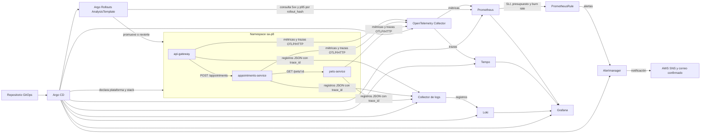

# Flujo de telemetría de P10

Una solicitud de cita propaga `traceparent` del gateway a citas y mascotas. El Collector envía las trazas a Tempo y las métricas a Prometheus. Los registros JSON de los pods van a Loki con el mismo `trace_id`, por lo que el operador puede pasar de una alerta en Grafana a la traza y luego al registro causal. `rollout_hash` separa las métricas de la candidata para que Argo Rollouts decida la promoción.

La aplicación del stack y del AnalysisTemplate procede de [GitOps](https://github.com/yaniadavid/Practicas-SA-B-202010175-P8); el diagrama representa el flujo operativo comprobado en las etapas 3 a 5.
